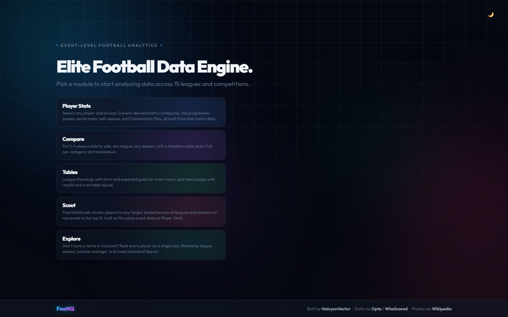
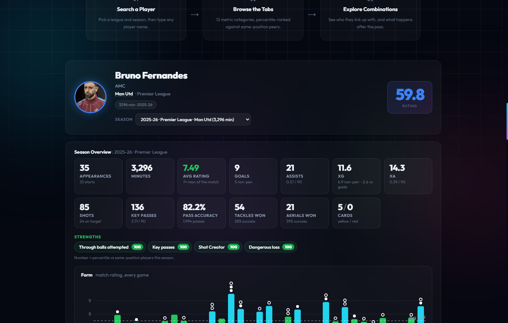

# FootIQ: What Football Event Data Says About a Player

How good is a player at the things that do not show up in a box score? FootIQ answers that from the match events themselves: every pass, carry, duel, tackle and shot in 15 competitions, with pitch coordinates, parsed into 131 metrics per player-season and ranked as percentiles against players in the same position group. Search a player and read their passing, carrying, shooting, aerial, defending, half-space, tempo and decision-making profiles, see which teammates they link up with, compare up to four players, find a statistical twin, or rank everyone in the dataset on a single metric.

Built with Python, pandas, pyarrow and Flask on parsed WhoScored/Opta match-event data, with client-side SVG charts and no front-end build step.

> **What it's for:** judging a player by what they actually do on the ball and against it, and knowing how much to trust each number, rather than reading a goals-and-assists line.

**Live demo: [footiq.onrender.com](https://footiq.onrender.com)** (the first request after a quiet spell can take up to a minute while the server starts)





---

## Disclaimer

**FootIQ is a personal, educational project and is not affiliated with WhoScored, Opta or any club or league.** The match events come from WhoScored's public match pages, which carry Opta data, and are used here for analysis only. The raw events are not redistributed in this repository. The expected-goals figures come from a small model fitted on this dataset's own shots, so treat them as informed estimates, not as Opta's xG. See Honest Limitations for what the numbers can and cannot support.

---

## Findings

What the data showed, and the problems found while building it:

- **Volume metrics repeat from year to year; success rates barely do.** Correlating each metric across consecutive finished seasons (2023-24 to 2024-25 and 2024-25 to 2025-26, pooled), for players with at least 900 minutes in both: pass accuracy r = 0.84, open-play xG per 90 r = 0.84, progressive passes per 90 r = 0.81, progressive carries per 90 r = 0.79. Success rates are far less stable: xG per shot r = 0.63, aerial win rate in the box r = 0.47, take-on success r = 0.37 and tackle success r = 0.09. A tackle success percentile is therefore mostly noise on a single season. Of the 125 metrics measured this way, 65 are rated high (r of 0.70 or more), 37 medium and 23 low. That is why rate metrics carry minimum-attempt gates, why the player page flags low-reliability metrics as "noisy", and why it shows an "Early season" chip while a competition is still being played.
- **Leagues differ in how midfielders move the ball.** Among midfielders with 900+ minutes across 2023-24 to 2025-26, the median progressive passes per 90 is highest in Ligue 1 (4.74) and lowest in Serie A (4.07), with La Liga at 4.46 and the Bundesliga and Premier League both at 4.22. Progressive carries per 90 tell a different story: the Premier League is highest at 0.40 and the Bundesliga lowest at 0.29. Percentiles are computed within a position group, not within a league, so cross-league comparison stays available but should be read with this in mind.
- **Minimum-sample gates hid a regular starter's profile early in a season.** A fixed "at least 10 aerial duels" gate is sensible over 38 games and wrong after 9. Bruno Fernandes had played over 700 minutes in 2026-27 and still showed dashes for open-play aerial win rate. The gates now scale with the share of the season played (never below 3 attempts), the percentile cohort's minutes floor relaxes from 450 to a minimum of 270, and the open-play aerial win rate now reads 25.0% (16th percentile). Finished seasons keep the full gates and are unchanged.
- **The weekly update ran for weeks without fetching anything.** The scheduler passed display names where the scraper needed the source's own league keys, every task crashed before its first request, and the error handling swallowed each crash and logged "No failures". Every weekly rebuild was quietly re-reading the cache from earlier manual scrapes. Fixed, and the scrape now reports any competition whose schedule could not be fetched instead of looking clean.
- **A health check reported 60 to 79% of current-season matches as unusable.** The cache holds a placeholder for every scheduled fixture, so a season a quarter played looked three quarters broken. Unplayed fixtures are now counted separately, which leaves the real gaps visible: finished seasons such as the Belgian Pro League 2025-26 (about 23% of matches without event data) and Scottish Premiership 2025-26 (about 13%).
- **A competition with no data at all was found by hand, then made a check.** Europa Conference League returned null event data for all 447 matches, a gap on the source's side, so it is excluded and the health check now looks for the same symptom after every scrape.

---

## Features

### Player Page

- Search across 15 competitions; every metric is a percentile against same-position players in the same competition and season.
- 12 Advanced Metrics tabs: Passing, Shooting and Footedness, Carrying, Half-Spaces, Tempo Control, Decision Making, Final Third, Aerial Duels, Defending, Hold-Up Play, Post-Recovery and Link-Up. Goalkeepers get a Goalkeeping tab instead.
- A season switcher for every competition and season a player appears in, and shareable URLs (`/player?player_id=&league=&season=`).
- A position-weighted Composite Rating that combines every category with a power mean, so a player's strongest categories are rewarded rather than diluted by ones that were never their job.
- Final Third scored two ways: Completeness (a geometric-mean floor across four pillars) and Impact (per-touch value from the two strongest pillars).
- Sample warnings: a "Limited sample" badge under 450 minutes and a third of the team's minutes, an "Early season" chip while the competition is in progress, and a "noisy" flag on metrics that repeat only weakly from one season to the next (hover any metric for its season-to-season correlation).

### Season Overview

- Stat line (appearances, goals, assists, xG, xA, average rating, cards), strengths and areas to improve generated from the percentiles, and a per-match form chart.
- A shot map sized by xG with a goal-placement view, touch and defensive-action heatmaps, and a pass map for chances created, progressive passes, passes into the box and incomplete passes.
- A career table across every season in the dataset.

### Combination Play

- A player's ten most-found teammates, and for a chosen teammate a pitch chart of exactly what happens after they receive a pass.

### Compare

- Two to four players side by side, any competition and season: stat line with the best value highlighted, shot maps, heatmaps, a full per-category table and a headline radar.

### Scout

- A statistical-twin search across every competition and season, or just the top five leagues, filterable by maximum age. The same engine lists six similar players on each player page.

### League Tables and Team Pages

- Points, goal difference, last-five form and xG for and against for every team, built from the per-match rows. Team pages add a goal-difference trend, a sortable squad table and every result with its xG.

### Data Coverage

- `/coverage` lists every competition and season with matches parsed, players found, how many clear the minutes floor for ranking and how much of the season has been played, plus what was left out and why.

### Explore

- Rank every player-season on one chosen metric, filtered by competition, season, position and minutes played.

---

## Data Source

| Source | Type | What It Provides |
|--------|------|-------------------|
| [WhoScored](https://www.whoscored.com/) match centre (Opta event data) | Match-event JSON, scraped | Every pass, carry, duel, tackle and shot with pitch coordinates and Opta qualifiers, plus line-ups, substitutions and ratings |
| [Wikipedia REST API](https://en.wikipedia.org/api/rest_v1/) | JSON | Player photos, cached locally |

Coverage is Premier League, La Liga, Serie A, Bundesliga, Ligue 1, Championship, Eredivisie, Primeira Liga, Belgian Pro League, Super Lig, Scottish Premiership, Champions League and Europa League for 2023-24 onwards (2026-27 in progress), plus the 2022 World Cup and Euro 2024 as one-off entries. That is 13,449 matches and 35,628 player-season rows. Europa Conference League was scraped in full and excluded because the source returned no usable events for any of its 447 matches.

**Cleaning and joining.** Raw match JSON is parsed into per-player events. Minutes are derived from line-ups and substitutions (stoppage-time aware), carries are reconstructed from gaps between a player's own touches, and open-play, set-piece, assist and cross events are separated using Opta qualifier codes. Events are aggregated per player-season into per-90 and percentage metrics, then percentile-ranked within position-group cohorts (attacker, midfielder, defender, goalkeeper) that must clear a minutes floor. Progressive passes and carries use the published three-tier yard rule; xG comes from a logistic model fitted on the dataset's own shots.

---

## Tech Stack

| Layer | Tech |
|---|---|
| Analysis | Python, pandas, numpy, pyarrow (Hive-partitioned parquet) |
| Scraping | soccerdata, SeleniumBase (undetected Chrome) |
| Backend | Flask, Flask-CORS, Flask-Compress, gunicorn |
| Charts | Client-side SVG (`static/js/charts.js`) drawn from JSON specs built in `visuals/specs.py` |
| Frontend | HTML, CSS and vanilla JS, no build step |
| Testing | pytest |

---

## Prerequisites

- **Python 3.11+**
- **Google Chrome**, only if you want to scrape new matches yourself
- **GitHub CLI (`gh`)**, only if you want to publish a rebuilt dataset

---

## Quick Start

```bash
pip install -r requirements.txt
python scraping/data_release.py fetch     # downloads and verifies the dataset (not stored in git)
python app.py
```

Open **http://127.0.0.1:5000**

To check a running deployment (health, memory, search, advanced stats and the link-up list):

```bash
py -3 deploy/live_check.py                # or pass another base URL as the first argument
```

### Refreshing the Data

The raw match-event JSON lives outside the repo (`WHOSCORED_CACHE_DIR` in `core/advanced/config.py`, override with the `FOOTIQ_WHOSCORED_DIR` environment variable).

```bash
python scraping/scrape_whoscored.py            # resumable, safe to re-run or interrupt
python scraping/build_advanced_metrics.py      # raw cache to data/advanced/*.parquet
python scraping/build_overview_data.py         # Season Overview tables and the xG model (about 15 minutes)
python scraping/build_extras.py                # home-page facts, metric reliability, coverage table (seconds)
python scraping/check_data_health.py           # reports matches with no usable events
python scraping/data_release.py publish        # uploads the dataset and rewrites data/DATA_VERSION
```

`scraping/auto_update.py` does all of this weekly, and a daily GitHub workflow checks that the published dataset is recent and still downloads.

---

## Project Structure

```
FootIQ/
├── app.py                       Flask routes, warm-up and in-memory chart cache
├── core/
│   ├── position.py               Position-group classification
│   ├── media.py                  Player photos, team colours
│   └── advanced/                 The event-metrics engine
│       ├── raw_loader.py          Parses raw WhoScored match JSON
│       ├── minutes.py             Per-player minutes (substitution and stoppage-time aware)
│       ├── geometry.py            Progressive-pass and carry tests, zones, angle bias
│       ├── qualifiers.py          Opta qualifier lookups (assists, crosses, set pieces)
│       ├── carries.py             Carries derived from gaps between touches
│       ├── possession_chains.py   Forward event tracing
│       ├── linkup.py              Combination Play pass and reception pipeline
│       ├── aggregator.py          Match parsing to a per-player-season rollup
│       ├── gates.py               Minimum-sample gates that scale with season progress
│       ├── categories/            One module per metric category
│       ├── percentiles.py         Cohort-based percentile ranking
│       ├── composite.py           Position-weighted Composite Rating
│       ├── scout.py, explore.py   Similarity search and single-metric ranking
│       ├── overview.py, xg.py     Season Overview tables and the xG model
│       ├── tables.py              League tables and team pages
│       ├── store.py               Lazy-loaded parquet access and memory trimming
│       ├── extras.py              Precomputed home-page facts, metric reliability and coverage (extras.json)
│       └── lookup.py              Player search index
├── visuals/specs.py             JSON chart specs for every tab, Combination Play and Compare
├── scraping/                    Scraper, parquet builders, data release, weekly update, health check
├── templates/, static/          Pages, stylesheet and vanilla JS
├── deploy/                      Hosting notes and the live check script
├── tests/                       Pytest suite
└── data/
    ├── DATA_VERSION               Pointer to the checksummed dataset (a GitHub Release asset)
    └── advanced/                  Precomputed parquet, the only data the app reads (not in git)
```

---

## Architecture

```
  WhoScored match JSON (scraped weekly, resumable)
              │
              ▼
  parse events ─► per-player-season metrics ─► percentile cohorts
              │                                       │
              ▼                                       ▼
  partitioned parquet (events, shots, heatmaps)   player_season_advanced.parquet
              │                                       │
              └──────────────► Flask app ◄────────────┘
                               │   JSON chart specs
                               ▼
                        vanilla JS + SVG charts
```

- **Per-request slices, not full tables.** Only the player-season table (about 50 MB) and a compact link-up table are held in memory. Event, shot and heatmap data are Hive-partitioned by league and season, and each request reads only its own player, league and season slice.
- **Memory.** The server runs one worker with two threads and returns freed memory to the operating system after loads and every twentieth data request. `/api/health` reports resident memory, which sits around 230 to 320 MB.
- **Start-up.** The server imports only Flask at first, so pages are served immediately; pandas, pyarrow and the data load in a background thread (started in the worker after the fork, never in the importing process). Data calls wait for it, and the client retries quietly and shows a short note while the server is waking. The home page's numbers and each metric's reliability are precomputed into `extras.json` with the data.
- **Data release.** The dataset is a content-hashed zip attached to a GitHub Release, pinned by `data/DATA_VERSION`. A deploy downloads and checksum-verifies it, so a bad release fails the build and the previous version keeps serving.
- **Charts.** The server builds JSON specs and the browser draws them as SVG, so every chart shares one theme-aware look with clickable legends and hover tooltips.

### API

| Endpoint | Method | Returns |
|---|---|---|
| `/api/search` | GET | Matching players |
| `/api/player` | GET | One player-season plus every season they appear in |
| `/api/advanced-stats` | POST | 12 metric categories, percentile-ranked |
| `/api/player-overview` | POST | Stat line, form, career, shots with xG, heatmaps |
| `/api/pass-map` | POST | Passes and chances created |
| `/api/category-chart` | POST | One category's chart grid |
| `/api/linkup-teammates`, `/api/linkup-detail` | POST | Combination Play |
| `/api/compare-stats` | POST | Side-by-side table and radar |
| `/api/scout-similar` | POST | Ranked statistical twins |
| `/api/explore` | POST | Ranked player-seasons for one metric |
| `/api/league-table`, `/api/team` | GET | Standings, results and squad |
| `/api/health` | GET | Warm-up state and memory use |

---

## Testing

```bash
pip install pytest
python -m pytest tests/
```

112 tests cover the metric math and the data handling around it: progressive-action geometry, position-group classification, the Composite Rating's power mean, the xG model and shot data, league tables, chart specs, the player search ranking, the link-up lookup, the season-progress gates (including that every category module that uses them imports them), partition-preserving writes and the dataset release logic. The scraper's schedule retries and the health check's treatment of unplayed fixtures are tested against simulated failures. Two tests are skipped on machines without the raw data.

---

## Honest Limitations

- **The data is not mine to redistribute.** Events are scraped from a public site and kept out of the repository, so the project is for analysis and learning, and a copy of it needs its own scrape or a copy of the dataset release.
- **Single-season percentiles on rate metrics are noisy.** Tackle success is almost unrelated from one season to the next (r = 0.09). Gates and the early-season chip reduce the problem, they do not remove it.
- **In-progress seasons are approximate.** Season progress is estimated from matches played and teams in the competition, the gates are relaxed in proportion, and the cohort is smaller, so percentiles move more week to week.
- **Four position groups only.** A wing-back and a centre-back share a cohort, and a false nine and a target man share another.
- **Events, not tracking.** There is no off-ball movement, pressing intensity from positions or player speed, only what the event feed records.
- **xG is a home-grown model**, fitted on the dataset's own shots with no goalkeeper position or defender pressure, so it will not match Opta's or other providers' figures.
- **Coverage has gaps.** Europa Conference League is excluded entirely, and some finished seasons have matches with no event data (the Belgian Pro League 2025-26 is the largest).
- **The data is only as fresh as the last weekly update**, which runs from a laptop and publishes a new dataset when it succeeds. A competition whose schedule cannot be fetched is skipped that week.
- **The server sleeps when idle**, so the first visit after a quiet spell is slow.

---

## Suggested Future Features

- **A metric glossary** with what each number measures, how it is computed and its minimum sample, shown from the stat itself.
- **Cohort choice:** rank a player against their own league or against every league.
- **Match-by-match trends for any metric**, not only the match rating.

---

## Author

**Sagnik**

GitHub: [@HalcyonVector](https://github.com/HalcyonVector)

---

## License

No license specified yet. Contact the author for usage rights.
